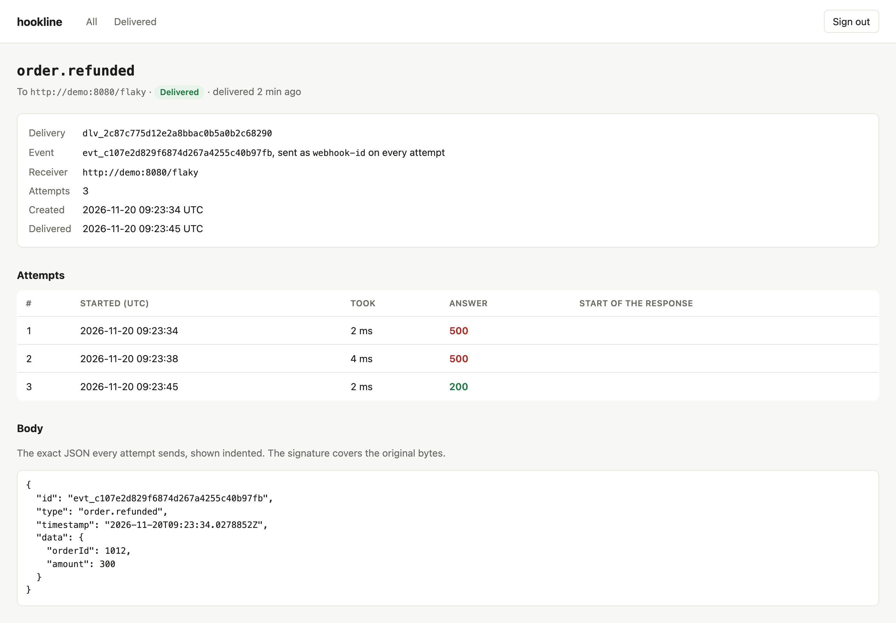

# hookline

[](https://github.com/mohsinaliwork686-rgb/hookline/actions/workflows/ci.yml)
[](LICENSE)


**Delivers webhooks reliably, even when the receiver is down.** An app posts its events to hookline,
which stores each one first, then delivers it to every subscriber: signed, retried with backoff, and
set aside for a person to look at after the last attempt. A dashboard shows every delivery and why it
failed, with a button to send a dead one again.

ASP.NET Core, EF Core and PostgreSQL, with `FOR UPDATE SKIP LOCKED` and leases so several workers
share the job without sending anything twice by accident. Tested against a real PostgreSQL and a real
HTTP receiver.


## The problem

Most apps send webhooks inline: inside the request that changed something, they POST to each
subscriber. When a receiver is down, slow or failing, the event is lost or the app's own request
hangs, and nobody can see what happened. Doing it properly takes a queue that survives restarts,
retries spread over days, signatures the receiver can check, a way to stop hammering a receiver that
asked for a break, and somewhere a person can see failures and resend. hookline is that piece, as a
service the app hands its events to.

## What it does

**Subscriptions.** A URL, the event types it wants (none means all), and a secret that hookline
generates and shows once.

```http
POST /api/subscriptions
Authorization: Bearer <api key>

{ "url": "https://receiver.example/hooks", "eventTypes": ["order.paid"] }
```

**Events.** The app posts an event. hookline saves it and one delivery per interested subscription
in one transaction, and only then answers `202`. An optional `Idempotency-Key` makes a retried
request return the first event instead of creating a duplicate.

```http
POST /api/events
Authorization: Bearer <api key>
Idempotency-Key: order-1042-paid

{ "type": "order.paid", "data": { "orderId": 1042, "amount": 3500 } }
```

**Deliveries.** Each delivery is a `POST` of the event, signed the
[Standard Webhooks](https://www.standardwebhooks.com/) way:

```http
POST /hooks
Content-Type: application/json; charset=utf-8
webhook-id: evt_6f1c...
webhook-timestamp: 1763470800
webhook-signature: v1,K7Hn0x...

{ "id": "evt_6f1c...", "type": "order.paid", "timestamp": "2026-11-18T13:00:00Z", "data": { ... } }
```

| The receiver answers | What hookline does |
|---|---|
| `2xx` within 15 seconds | Delivered |
| `429` or `503` with `Retry-After` | Waits at least that long, up to the schedule's longest wait |
| `410 Gone` | Dead at once; the subscription is disabled and its other waiting deliveries end |
| `3xx` | A failure. Redirects aren't followed, so a signed request never goes somewhere unregistered |
| Anything else, a timeout or no connection | Retried. Ten attempts in all: at once, then 5 s, 5 min, 30 min, 2 h, 5 h, 10 h, 14 h, 20 h and 24 h after the one before, each wait with up to 10% jitter |

After the tenth attempt the delivery is dead. **The dashboard** lists deliveries by status, shows each
one's attempts with the status code, time taken and the start of the answer, and has **Send again**
for dead ones.



## Try it

```sh
docker compose up --build
```

Then open <http://localhost:5080> and sign in with `demo`. The demo app subscribes five paths on a
receiver that misbehaves on purpose and posts a dozen events, four seconds apart. It uses a short
schedule (five attempts, 0 to 20 seconds apart) and a 5-second timeout, so the whole story plays out
in about a minute and a half:

| Path | Behaviour | What you see |
|------|-----------|--------------|
| `/ok` | answers `200` | delivered on the first attempt |
| `/flaky` | fails twice per event, then `200` | delivered on the third attempt |
| `/slow` | takes 20 seconds | every attempt times out, and nothing else waits for it |
| `/down` | always `500` | five attempts, then a dead letter to send again |
| `/gone` | answers `410` | dead at once; later events skip it |

The receiver checks every signature with hookline's own verifier and logs what it saw
(`docker compose logs -f demo`):

```text
09:23:01 /flaky evt_049fc9a31bbb047ee8d529ef7a44a06b  signature ok  answered 200
09:23:04 /slow  evt_049fc9a31bbb047ee8d529ef7a44a06b  signature ok  hookline timed out and hung up
09:23:14 /down  evt_049fc9a31bbb047ee8d529ef7a44a06b  signature ok  answered 500
```

`docker compose down --volumes` starts it again from nothing.

## The guarantees

- **Nothing accepted is lost.** The event and its deliveries are committed before the `202`. If the
  save fails, the app gets an error and can retry.
- **At least once.** If a worker dies holding a delivery, its lease runs out and another worker takes
  it, so a receiver can see an event twice. `webhook-id` is the same on every attempt, so it can drop
  repeats.
- **No two workers send one delivery at once.** A worker takes due deliveries with
  `FOR UPDATE SKIP LOCKED`, which passes over rows another worker is taking at that instant, and
  stamps a lease on them. It records a result only while the lease is still its own, so a worker
  that was too slow can't overwrite a newer result.
- **A slow receiver holds up only its own delivery.** Each worker keeps up to ten requests in flight
  and takes new work as soon as one finishes. No database connection is held while a request is out.
- **Every attempt is signed afresh** with the current time over the exact stored bytes, so a receiver
  can reject a replayed request that is more than 5 minutes old.

And what it doesn't promise: **ordering** (a retry can arrive after a newer event), **exactly once**
(nobody can over HTTP), protection against subscriptions that point at **internal addresses**, or
secret rotation. The full list of non-goals is in the [plan](docs/IMPLEMENTATION_PLAN.md#2-non-goals).

## How it works

```text
 app ──POST /api/events──▶ hookline API ──one transaction──▶ events + deliveries (PostgreSQL)
                                                                     │
                     ┌───────────── take due rows: SKIP LOCKED + lease ┘
                     ▼
          worker (one or many) ──sign + POST──▶ receiver
                     │
                     └── record the attempt, if the lease is still ours:
                         delivered · due again later · dead
```

Taking work is one statement, so one short transaction:

```sql
WITH due AS (
    SELECT id FROM deliveries
    WHERE status = 'Pending' AND next_attempt_at <= @now
      AND (locked_until IS NULL OR locked_until <= @now)
    ORDER BY next_attempt_at
    LIMIT @limit
    FOR UPDATE SKIP LOCKED)
UPDATE deliveries SET locked_until = @until, lease_id = @lease
FROM due WHERE deliveries.id = due.id
```

The retry policy and the signing are plain C# in `Hookline.Core`, with no database or HTTP, and take
the time as an argument, so the tests pin both the clock and the jitter.

## Checking a signature

Any Standard Webhooks library works. In .NET, `Hookline.Core` has the verifier the demo uses:

```csharp
var problem = WebhookSignature.Verify(
    secret,                                  // whsec_... from when the subscription was created
    request.Headers["webhook-id"],
    request.Headers["webhook-timestamp"],
    request.Headers["webhook-signature"],
    body,                                    // the raw bytes, before any JSON parsing
    DateTimeOffset.UtcNow,
    TimeSpan.FromMinutes(5));

if (problem is not null) return Results.Unauthorized();
```

## Configuration

| Setting | Default | What it is |
|---|---|---|
| `ConnectionStrings:Hookline` | (required) | PostgreSQL |
| `Hookline:ApiKey` | (required) | The bearer key the sending app uses |
| `Hookline:AdminPassword` | none | Opens the dashboard. Without it the dashboard stays shut |
| `Database:MigrateOnStartup` | `false` | Apply migrations when the app starts |
| `Delivery:Enabled` | `true` | Run the worker in this process |
| `Delivery:Parallelism` | `10` | Requests in flight at once, per process |
| `Delivery:BatchSize` | `50` | The most deliveries taken in one go |
| `Delivery:Timeout` | `00:00:15` | Per attempt |
| `Delivery:Lease` | `00:02:00` | Must be longer than the timeout |
| `Delivery:Schedule` | Standard Webhooks | The wait before each attempt, as a list |
| `Delivery:Jitter` | `0.1` | Up to this share of each wait is added at random |

In environment variables, `:` becomes `__`, as in `compose.yaml`.

## Development

Needs the .NET 10 SDK, and Docker for the API tests.

```sh
dotnet test --solution Hookline.slnx                                 # everything (109 tests)
dotnet run --project tests/Hookline.Api.Tests -- -class "Hookline.Api.Tests.WorkerTests"
```

- **`Hookline.Core.Tests`** (64): the retry schedule and jitter, which answers count as what,
  `Retry-After`, and signing, including the fixed example from the Standard Webhooks reference
  library's tests.
- **`Hookline.Api.Tests`** (45): the API, the worker and the dashboard against PostgreSQL in
  Testcontainers and a real HTTP receiver on a local port, with the clock faked. Among them: a worker
  that dies holding a delivery, a row another worker has locked mid-claim, three app copies sharing
  one database, a receiver that hangs while others keep being served, redirects, `410`, timeouts,
  refused connections, and Send again.

To check that the worker tests catch what they claim to, I broke the worker 16 ways (no lease
check, no `SKIP LOCKED`, redirects followed, one request at a time, a loop that waits for a whole
batch, and so on). Each break fails the test meant for it.

CI checks formatting, builds with warnings as errors, runs everything on Linux and the core tests
on Windows and macOS, and builds the demo images.

| Project | What it holds |
|---|---|
| `src/Hookline.Core` | The retry policy, signing and verifying, ids. No database, no HTTP |
| `src/Hookline.Api` | The ingest API, the delivery worker, the dashboard (Razor Pages), EF Core and migrations |
| `src/Hookline.DemoReceiver` | The demo's sending app and misbehaving receiver |

The plan, written before the code, is in [docs/IMPLEMENTATION_PLAN.md](docs/IMPLEMENTATION_PLAN.md),
and the notes on how Standard Webhooks, Stripe, GitHub and Svix do it are in
[docs/research-webhooks.md](docs/research-webhooks.md). Built from 18 to 20 November 2026.

## Licence

MIT
